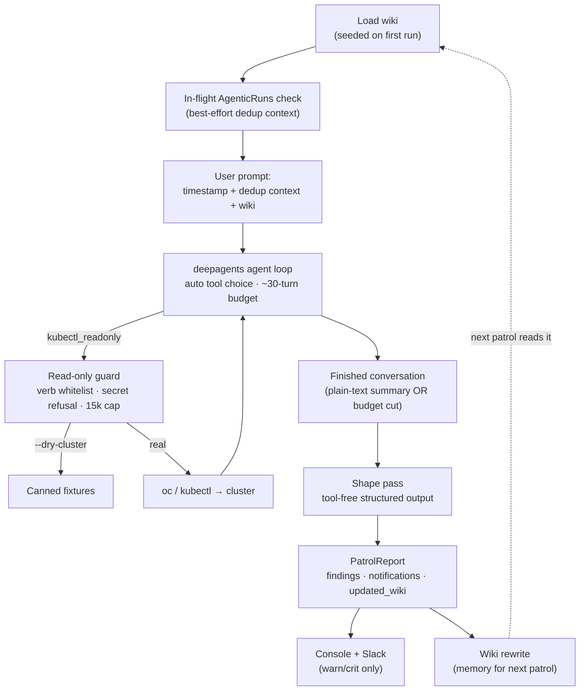
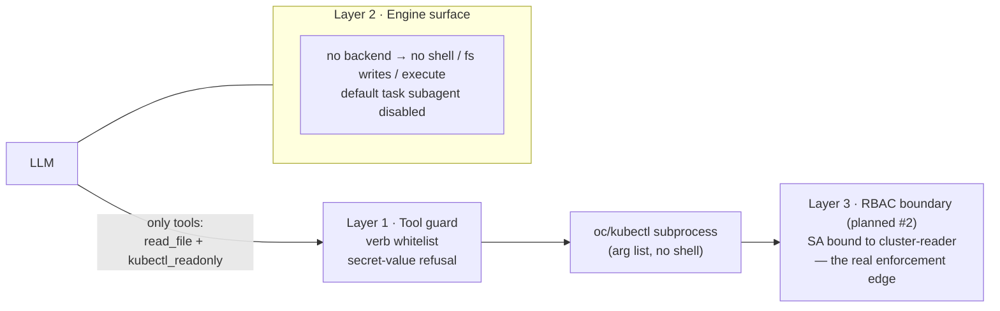
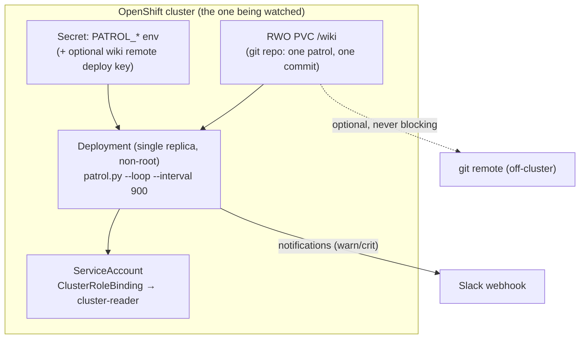

# OLS Patroller — Architecture

OLS Patroller is a proactive, non-deterministic SRE agent ("resident SRE") for
OpenShift/Kubernetes clusters. Instead of waiting for alerts, it does its rounds on a
schedule: an LLM agent explores the cluster **read-only**, checks what it finds
against a persistent markdown **wiki** (its own memory from previous patrols),
rewrites that wiki, and notifies a human about anything that looks wrong. The wiki is
the differentiator — a living, self-correcting knowledge base of one specific
cluster's topology, baselines, and watch-list, refined patrol after patrol.

It is a hacky single-file PoC (`patrol.py`, tracked in
[OLS-4439](https://redhat.atlassian.net/browse/OLS-4439)) whose safety model is held
to production standards. Roadmap: GitHub issues + milestones (v0.1 in-cluster, v0.2
compounding wiki, v0.3 operational hardening).

## One patrol, end to end

The patrol engine is upstream
[deepagents](https://github.com/langchain-ai/deepagents) (`create_deep_agent`) — the
same library the OLS agentic sandbox uses, depended on directly with **no OLS code
imported**. The agent decides for itself what to look at (real patrols: 33–63 tool
calls), then either self-terminates with a plain-text summary or is cut off by the
step budget; both endings flow through the same **shape pass**
(`with_structured_output`) that types the report. There is deliberately **no
in-agent response format**: forcing `tool_choice="any"` removed the model's natural
stopping signal (GLM never self-terminated under it — see
`.ai/spec/decisions/0002`).

## Safety model: read-only by construction

Three layers, and the guard is explicitly **defense-in-depth, not the boundary**: when
deployed in-cluster, the pod ServiceAccount's RBAC (the built-in `cluster-reader`
role — no Secret access) is the server-side enforcement edge. The patrol never
mutates the cluster; remediation is delegated to a governed AgenticRun (approval +
audit) rather than grown locally — the patrol is the eyes and memory, the AgenticRun
is the hands (`.ai/spec/decisions/0004`).

## The memory loop

The wiki (`wiki/cluster-wiki.md`) is read fully at patrol start and wholly rewritten at
patrol end. Entries carry `(source, timestamp, confidence)` tags; the **watch-list**
section is the refinement loop — patrol N writes the rules patrol N+1 follows
("still unfixed at 2nd patrol", "downgraded to FYI after 4.6h non-recurrence"). The
epistemic rule is fixed in the prompt: the wiki is hypotheses, the live cluster is
truth; every patrol re-validates and expires stale claims. Since patrols are
non-deterministic, the wiki plus logs are the audit trail.

The wiki directory is a git repo (#3, `.ai/spec/decisions/0003`): one wiki-changing
patrol, one commit (`patrol N: X findings, Y warn`), atomic writes (temp + rename),
optional `PATROL_WIKI_REMOTE` replication that never blocks the loop — in-cluster it
lives on the `/wiki` PVC. Planned next (v0.2): a skeleton schema, per-entry
`recheck:` commands, `stale_after` expiry, and `--wiki-stats` health numbers.

## Deployment topology (current vs planned)

Today the patroller runs as a CLI process (`uv run patrol.py --loop`) against a
kubeconfig. Planned in-cluster shape (v0.1, issues #1–#2):

A `PatrolSchedule` CRD is planned to replace the `--loop` process eventually
(#14, future milestone), with per-schedule cadence/scope/model config.

## Key decisions (short form)

| Decision | Why | Record |
|---|---|---|
| deepagents engine, direct dependency | Engine alignment with the OLS sandbox without importing OLS code | `.ai/spec/decisions/0001` |
| Shape pass, not in-agent ToolStrategy | Forced tool choice killed self-termination; shape pass made patrols 4.7× cheaper | `.ai/spec/decisions/0002` |
| Git-backed wiki, not MCP memory | Single-writer whole-file access pattern; revert insurance; federation later | `.ai/spec/decisions/0003` |
| Read-only patrol + delegated remediation | Structural safety; act via governed AgenticRuns with approval + audit | `.ai/spec/decisions/0004` |

Agent-facing specs (numbered behavioral rules, module maps, guard contract) live in
`.ai/spec/` — start at `.ai/spec/README.md`.
